# Mesh-Hand

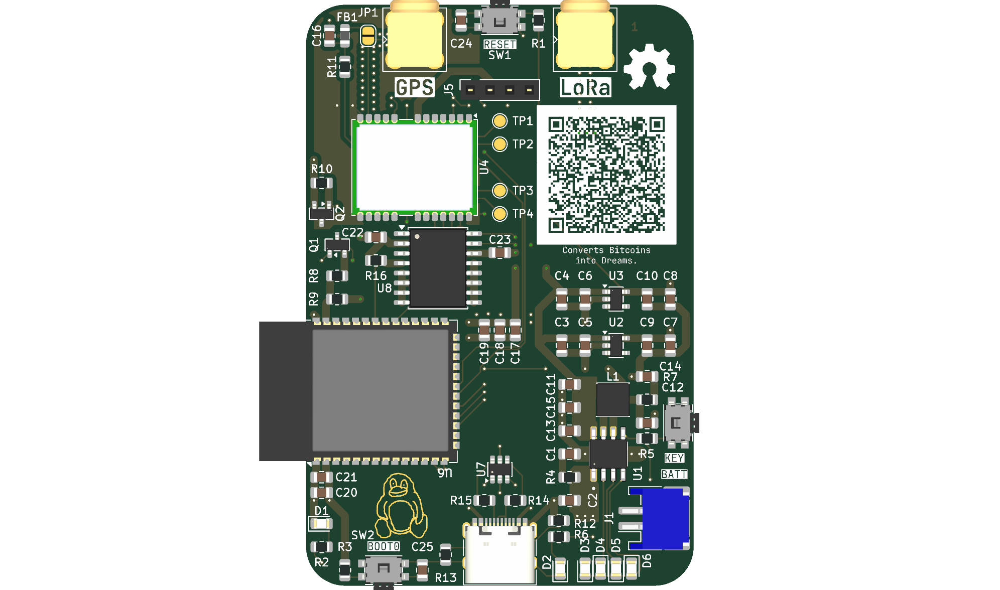

## Description
A Handheld Meshtastic Node with GPS on board. The device is designed to be compact and portable, making it ideal for outdoor activities such as hiking, camping, and other adventures.

## Why I Made This

I wanted to make a second revision of my previous handheld meshtastic board.
I also thought it would be a great project to have on my portfolio.

## How to Use
1. Plug 3.7v Lithium battery into JST-PH port
2. Connect to USB-C
3. Flash Meshtastic or other firmware
4. Connect to board via WiFi, Bluetooth, or USB1
5. Use the device as a meshtastic node

## BOM

| Refs | Value | Footprint | Qty |
|------|-------|-----------|-----|
| C1, C2, C5-C8, C12, C14, C18, C21, C23 | 10uF | C_0805_2012Metric | 11 |
| C3, C4, C9, C10, C17, C20, C22, C24, C25 | 0.1uF | C_0805_2012Metric | 9 |
| C11, C13, C15, C19 | 22uF | C_0805_2012Metric | 4 |
| C16 | 47pF | C_0805_2012Metric | 1 |
| D1-D6 | LED | LED_0805_2012Metric | 6 |
| FB1 | 30R/1.8A | L_0805_2012Metric | 1 |
| J1 | Conn_01x02 | JST_PH_S2B-PH-SM4-TB_1x02-1MP_P2.00mm_Horizontal | 1 |
| J2 | SMA | SMA_Amphenol_901-143_Horizontal | 1 |
| J3 | Conn_Coaxial | SMA_Amphenol_901-143_Horizontal | 1 |
| J4 | USB_C_Receptacle_USB2.0_16P | USB_C_Receptacle_HRO_TYPE-C-31-M-12 | 1 |
| J5 | Conn_01x04 | PinSocket_1x04_P2.54mm_Vertical | 1 |
| L1 | 1uH XFL4020-102MEC | L_Coilcraft_XxL4020 | 1 |
| Q1, Q2 | AO3400A | SOT-23 | 2 |
| R1-R3, R5, R6, R10, R16 | 10k | R_0805_2012Metric | 7 |
| R4, R7 | 2 | R_0805_2012Metric | 2 |
| R8 | 390k | R_0805_2012Metric | 1 |
| R9 | 100k | R_0805_2012Metric | 1 |
| R11 | 10 | R_0805_2012Metric | 1 |
| R12, R13 | 5.1k | R_0805_2012Metric | 2 |
| R14, R15 | 22 | R_0805_2012Metric | 2 |
| SW1-SW3 | SW_Push | Panasonic_EVQPUM_EVQPUD | 3 |
| TP1 | TestPoint | TestPoint_Pad_D1.5mm | 1 |
| U1 | IP5306 | SOP127P600X165-9N | 1 |
| U2, U3 | TLV75733PDBV | SOT-23-5 | 2 |
| U4 | NEO-M9N | ublox_NEO | 1 |
| U5 | E22-900M30S | XCVR_E22-900M30S | 1 |
| U6 | ESP32-S3-WROOM-1 | ESP32-S3-WROOM-1U | 1 |
| U7 | USBLC6-2SC6 | SOT-23-6 | 1 |
| U8 | DS3231M | SOIC-16W_7.5x10.3mm_P1.27mm | 1 |

Full BOM in kicad/production/bom.csv

## Images

PCB Render (top)

PCB Render (bottom)
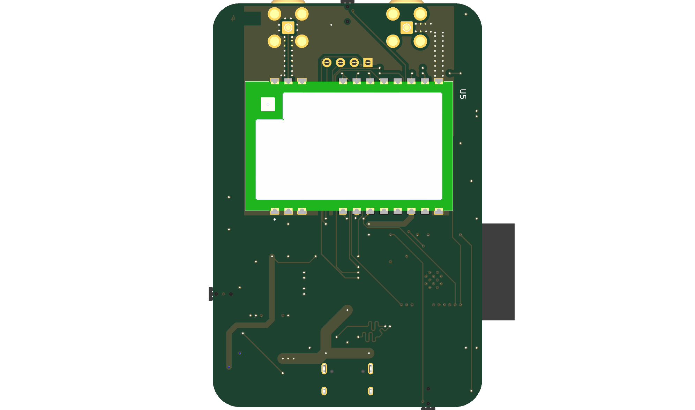

PCB Render (isometric)

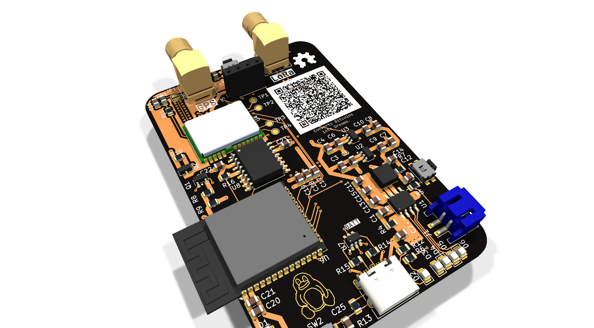

Schematic
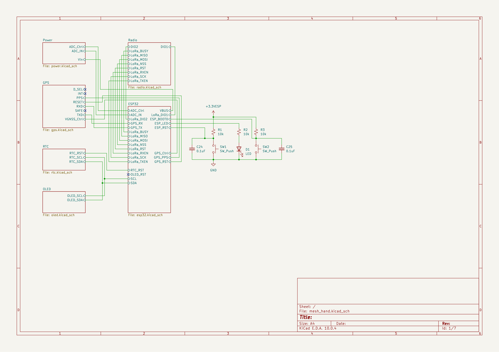
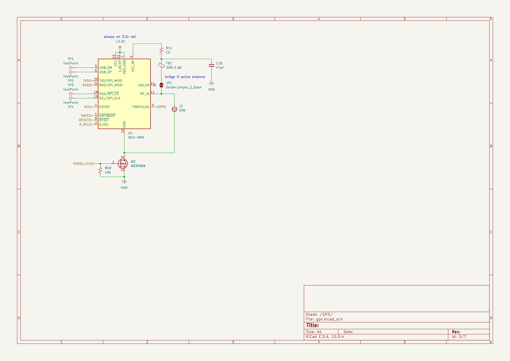
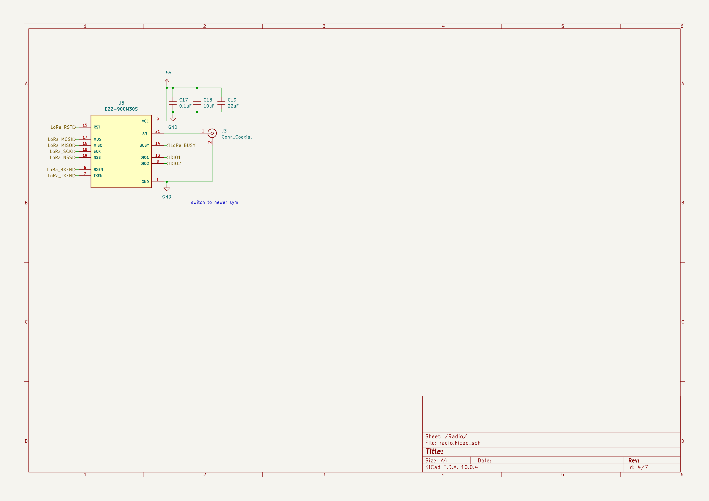
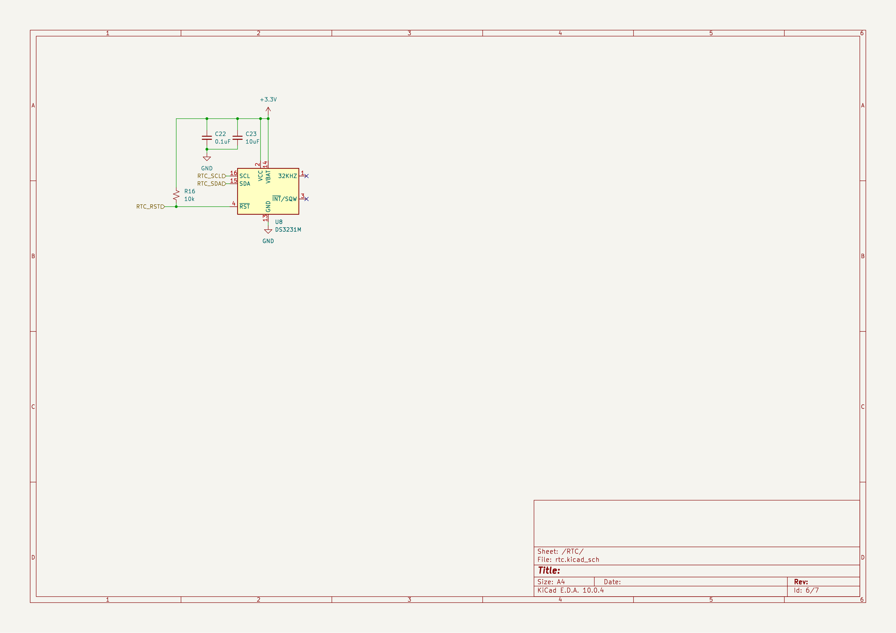
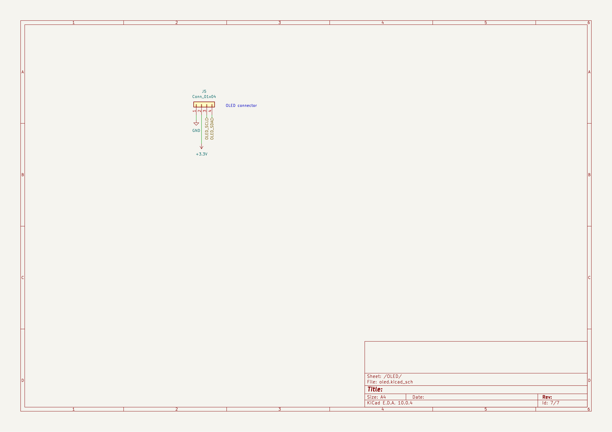
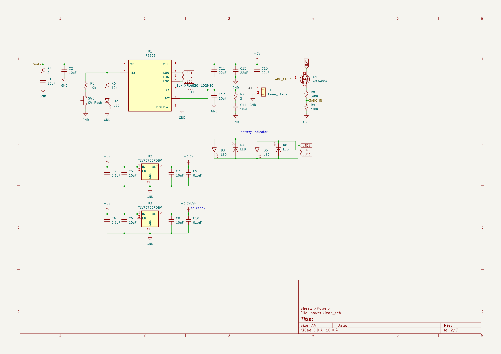
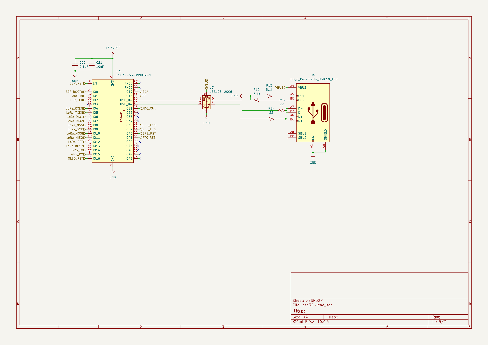

Editor
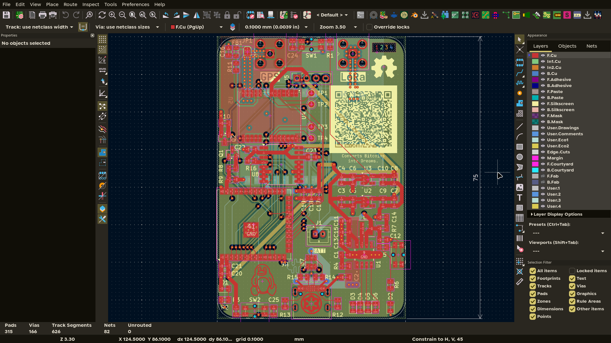

Blender Render (V1)
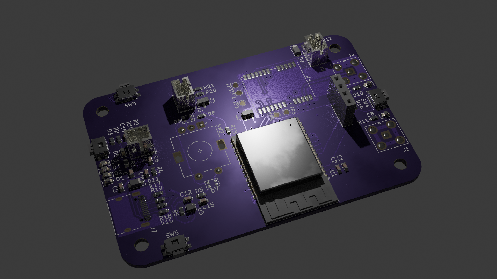

Cart (V1)
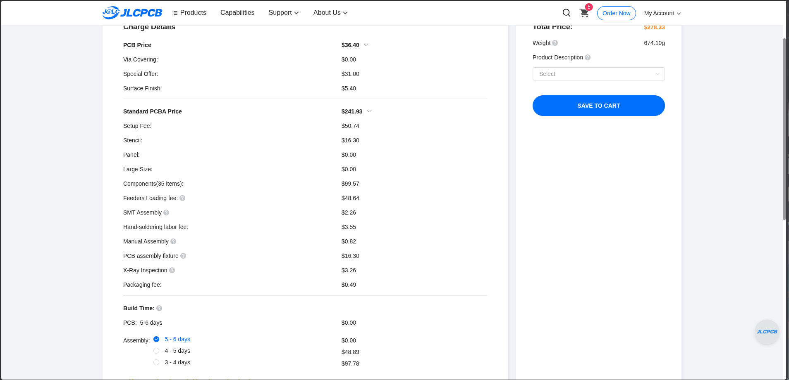

