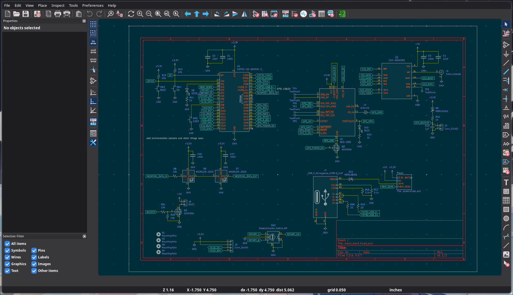
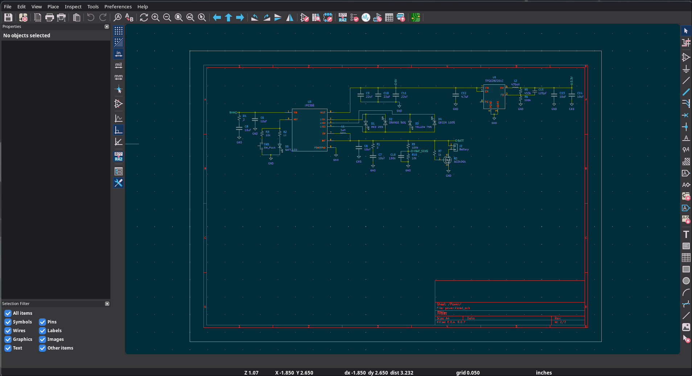
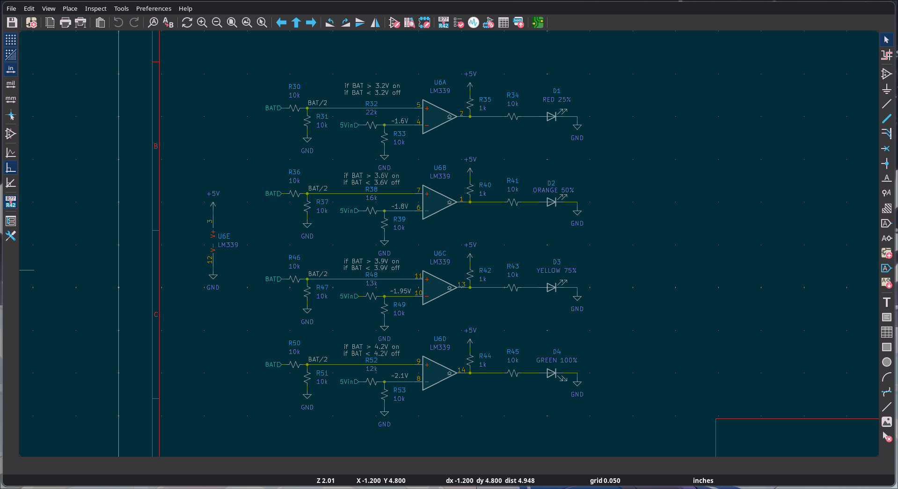
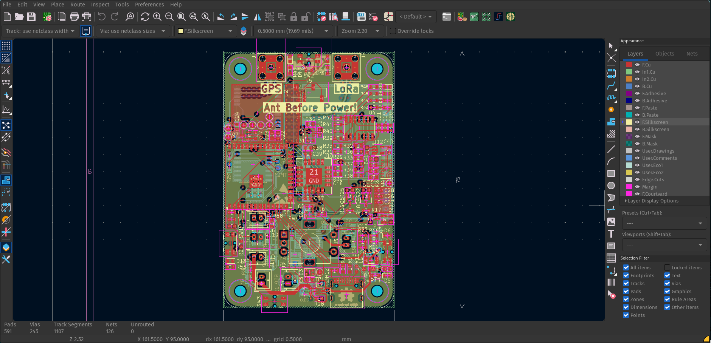
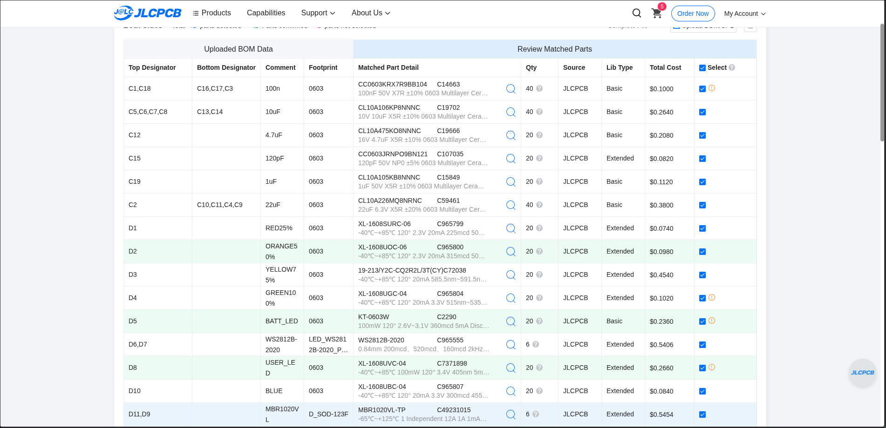
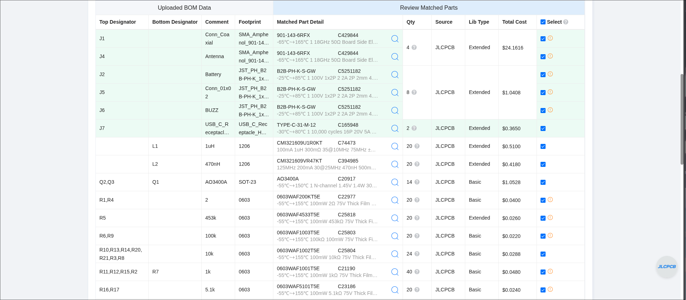
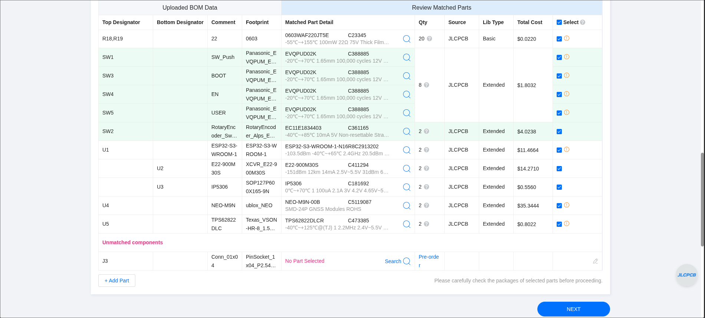
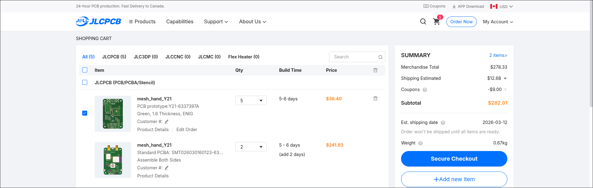

# Mesh-Hand

## Description
A Handheld Meshtastic Node with GPS on board. The device is designed to be compact and portable, making it ideal for outdoor activities such as hiking, camping, and other adventures.

## Why I Made This

I wanted to make a second revision of my previous handheld meshtastic board.
I also thought it would be a great project to have on my portfolio.

## How to Use
1. Plug 3.7v Lithium battery into JST-PH port
2. Connect to USB-C
3. Flash Meshtastic or other firmware
4. Connect to board via WiFi, Bluetooth, or USB1
5. Use the device as a meshtastic node

## Pictures
not done yet but add full 3d model screenshots and PCB renderings here and wiring diagram

## BOM
Full BOM in BOM.csv

## Images

Blender Render

Schematic & PCB View

Cart

+